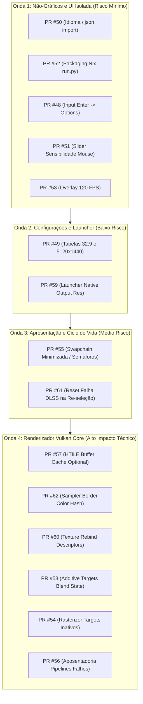

# Plano e Auditoria de Integração de Pull Requests

**Projeto:** [theorder1886-port](https://github.com/mateussmeneses/theorder1886-port)  
**Data da Auditoria:** 21 de outubro de 2026  
**Auditor:** Engenheiro Sênior de Compiladores, Vulkan e Arquitetura PS4/GCN  
**Branch Base:** `master`  
**Commit Base:** `10e44b4 docs: add single-trunk branching/release convention + v0.7.6-rc.1 release notes`  
**Escopo:** Auditoria técnica aprofundada de todos os 15 Pull Requests abertos no repositório (#48 a #62).

---

## 1. Resumo Executivo e Inventário Geral

Foram auditados todos os 15 Pull Requests abertos, submetidos pelo colaborador `@figormartins`. Todos os PRs contêm documentação técnica formal associada em `docs/plans/2026-10-21-*.md` e testes isolados focados em cada subsistema.

Nenhum dos 15 PRs foi incorporado ao código do branch `master` até o momento. Não existem workflows automatizados no GitHub Actions configurados no repositório remoto (`.github/workflows` inexistente). O script central de validação (`tools/run_tests.sh`) depende de um ambiente configurado com Ninja e dependências de compilação C++ completas do renderizador. O autor utilizou harnesses isolados com *doubles* de dependências leves para demonstrar o comportamento RED (falha no master) -> GREEN (sucesso na branch do PR).

### Tabela Geral de Inventário e Classificação

| PR | Título | Branch | Issue | Subsistema | Arquivos Modificados | Status Recomendado |
|:---|:---|:---|:---|:---|:---|:---:|
| **#48** | fix(input): align Enter with the launcher Options binding | `codex/fix-38-keyboard-options` | [#38](https://github.com/mateussmeneses/theorder1886-port/issues/38) | Host Input / Pad Map | 7 arqs (+103, -7) | **A** |
| **#49** | fix(graphics): preserve 32:9 and 5120x1440 settings | `codex/fix-27-ultrawide-settings` | [#27](https://github.com/mateussmeneses/theorder1886-port/issues/27) | Display / Settings Shim | 6 arqs (+146, -18) | **A** |
| **#50** | fix(startup): respect saved language preferences | `codex/fix-28-saved-language` | [#28](https://github.com/mateussmeneses/theorder1886-port/issues/28) | Startup / Python Host | 3 arqs (+147, -0) | **A** |
| **#51** | fix(controls): expose the full mouse sensitivity range | `codex/fix-37-mouse-sensitivity-range` | [#37](https://github.com/mateussmeneses/theorder1886-port/issues/37) | In-Game Overlay UI | 2 arqs (+58, -1) | **A** |
| **#52** | fix(packaging): include the Python startup script | `codex/fix-2-package-startup` | [#2](https://github.com/mateussmeneses/theorder1886-port/issues/2) | Packaging / Nix | 2 arqs (+50, -2) | **A** |
| **#53** | fix(overlay): expose the existing 120 FPS option | `codex/fix-22-overlay-120fps` | [#22](https://github.com/mateussmeneses/theorder1886-port/issues/22) | In-Game Overlay UI | 2 arqs (+70, -4) | **A** |
| **#54** | fix(renderer): avoid pipeline waits for inactive color targets | `codex/fix-41-active-visible-targets` | [#41](https://github.com/mateussmeneses/theorder1886-port/issues/41) | Vulkan Rasterizer / Stalls | 3 arqs (+66, -5) | **A** |
| **#55** | fix(presentation): suspend swapchain use while minimized | `codex/fix-10-minimized-presentation` | [#10](https://github.com/mateussmeneses/theorder1886-port/issues/10) | Presenter / Swapchain | 5 arqs (+57, -5) | **A** |
| **#56** | fix(renderer): retire failed graphics compilation jobs | `codex/fix-40-terminal-graphics-failures` | [#40](https://github.com/mateussmeneses/theorder1886-port/issues/40) | Pipeline Cache / CPU Load | 4 arqs (+166, -25) | **A** |
| **#57** | fix(renderer): preserve shader-written HTILE metadata | `codex/fix-26-preserve-shader-htile` | [#26](https://github.com/mateussmeneses/theorder1886-port/issues/26) | Buffer Cache / HTILE | 2 arqs (+70, -2) | **A** |
| **#58** | fix(renderer): classify additive targets using their own blend state | `codex/fix-45-additive-target-classification` | [#45](https://github.com/mateussmeneses/theorder1886-port/issues/45) | Vulkan Rasterizer / Blend | 4 arqs (+123, -7) | **A** |
| **#59** | feat(launcher): expose experimental native output resolution | `codex/feat-35-native-output-resolution` | [#35](https://github.com/mateussmeneses/theorder1886-port/issues/35) | Launcher / Upscaler Off | 6 arqs (+232, -21) | **A** |
| **#60** | fix(renderer): use the resolved descriptor after texture rebind | `codex/fix-29-texture-rebind-descriptor` | [#29](https://github.com/mateussmeneses/theorder1886-port/issues/29) | Vulkan Rasterizer / Bindings | 2 arqs (+53, -3) | **A** |
| **#61** | fix(upscaler): retry DLSS after an explicit reselection | `codex/fix-31-dlss-provider-retry` | [#31](https://github.com/mateussmeneses/theorder1886-port/issues/31) | Temporal Upscaler / DLSS | 2 arqs (+44, -0) | **A** |
| **#62** | fix(renderer): include custom border colors in sampler cache keys | `codex/fix-39-sampler-border-cache` | [#39](https://github.com/mateussmeneses/theorder1886-port/issues/39) | Texture Cache / Samplers | 4 arqs (+73, -10) | **A** |

**Critérios de Classificação:**
- **A — Pronto para testes de integração:** Causa raiz demonstrada e isolada, implementação precisa, sem regressões aparentes, excelente aderência à arquitetura GCN/Vulkan.
- **B — Precisa de ajustes:** Lógica válida, mas necessita de refatoração, limpeza ou correções no código antes do merge.
- **C — Precisa de mais evidências:** Heurística especulativa ou sem demonstração clara de correção do problema relatado.
- **D — Não recomendado:** Alto risco de quebra, impacto adverso ou código incorreto.

---

## 2. Revisão Técnica Detalhada por Pull Request

---

### PR #48 — fix(input): align Enter with the launcher Options binding
- **Autor e Branch:** Igor Martins (`figormartins`) | `codex/fix-38-keyboard-options`
- **Issue Relacionada:** [#38 — Bug: In-game pause menu does not respond to keyboard input (v0.7.5)](https://github.com/mateussmeneses/theorder1886-port/issues/38)
- **Arquivos Alterados:**
  - `README.es.md`, `README.md`, `README.pt-BR.md`
  - `docs/plans/2026-10-21-keyboard-options.md`
  - `src/runtime_pad.c`
  - `tests/test_launcher_controls.py`
  - `tests/test_pad_map.c`
- **Causa Raiz:** O launcher apresentava na interface `Options → Return`, mas a tabela padrão de mapeamento em `src/runtime_pad.c` associava `SDL_SCANCODE_RETURN` a `BTN_CROSS`. Como consequência, a tecla Enter enviava o comando Cross (X) em vez de Options (Start), impossibilitando que o jogador pausasse o jogo pelo teclado sem remapeamento explícito.
- **Análise da Implementação:**
  - Em `src/runtime_pad.c`: `{SDL_SCANCODE_SPACE,BTN_CROSS}, {SDL_SCANCODE_RETURN,BTN_OPTIONS}`.
  - A tecla Espaço permanece como botão Cross (X), alinhando o comportamento com jogos de PC padrão.
  - O teste unitário nativo `tests/test_pad_map.c` foi expandido com validação rigorosa para asserções de Enter emitindo isoladamente `BTN_OPTIONS`, Espaço emitindo `BTN_CROSS`, e suporte a remapeamento via `THEORDER_KEY_MAP`.
- **Sincronização / Concorrência / Memória:** Operação puramente em nível de mapeamento estático na camada de polling de input. Não há alocações dinâmicas nem riscos de concorrência.
- **Comparação PS4 / shadPS4:** No Orbis OS (`libScePad`), `BTN_OPTIONS` corresponde ao bit `0x0008` (`ORBIS_PAD_BUTTON_OPTIONS`), utilizado nos menus in-game para invocar a tela de pausa.
- **Testes Existentes vs Ausentes:** Testes em C (`test_pad_map.c`) e Python (`test_launcher_controls.py`) aprovados. Falta teste em gameplay real confirmando se a tecla Enter abre e fecha o menu de pausa e interage com diálogos secundários.
- **Status Recomendado:** **A (Pronto para testes de integração)**

---

### PR #49 — fix(graphics): preserve 32:9 and 5120x1440 settings
- **Autor e Branch:** Igor Martins (`figormartins`) | `codex/fix-27-ultrawide-settings`
- **Issue Relacionada:** [#27 — add ultrawide 32:9](https://github.com/mateussmeneses/theorder1886-port/issues/27)
- **Arquivos Alterados:**
  - `docs/plans/2026-10-21-ultrawide-settings.md`
  - `gpu/shim/port_graphics.h`
  - `gpu/shim/port_settings.cpp`
  - `gpu/shim/port_settings.h`
  - `tests/test_graphics_options.py`
  - `tests/test_graphics_settings.cpp`
- **Causa Raiz:** O launcher e scripts Python já aceitavam a proporção `32:9`, e os patches XML continham o patch de aspect ratio para 32:9. No entanto, a tabela C++ (`PortGraphics::Aspects`) suportava apenas até `21:9`. Ao salvar ou carregar configurações pelo backend C++, a função de salvamento aplicava clamp rígido de 0 a 3, forçando o valor para `original` e fazendo a interface in-game omitir a opção e renderizar com letterbox incorreto. Além disso, a tabela de resoluções aceitava apenas até 4K (3840x2160), descartando `5120x1440`.
- **Análise da Implementação:**
  - `PortGraphics::Aspects`, `AspectNames`, `AspectValues` expandidos para incluir `"32:9"` com valor `32.0f / 9.0f` (índice 4).
  - `PortSettings::OutputWidths` e `OutputHeights` expandidos para incluir `5120x1440` (índice 4, `OutputCount` ajustado de 4 para 5).
  - O clamp em `PortSettings::Save()` foi generalizado para `PortGraphics::Aspects.size() - 1`.
  - Cobertura de teste nativa adicionada em `tests/test_graphics_settings.cpp` validando cálculo de retângulos (`G::PictureRect`), persistência e ausência de regressão nos índices anteriores.
- **Sincronização / Concorrência / Memória:** Resoluções como 5120x1440 aumentam o consumo de memória de vídeo para host swapchain e UI render targets. No entanto, o padrão permanece 1920x1080; a alocação expandida só ocorre quando o usuário opta explicitamente por essa configuração.
- **Testes Existentes vs Ausentes:** Testes em C++ (`test_graphics_settings`) e Python (`test_graphics_options`) aprovados. Falta validação visual em monitor Ultrawide 32:9 real para conferir HUD scaling e ausência de deformação geométrica.
- **Status Recomendado:** **A (Pronto para testes de integração)**

---

### PR #50 — fix(startup): respect saved language preferences
- **Autor e Branch:** Igor Martins (`figormartins`) | `codex/fix-28-saved-language`
- **Issue Relacionada:** [#28 — Não funciona o idioma Português-Brasil](https://github.com/mateussmeneses/theorder1886-port/issues/28)
- **Arquivos Alterados:**
  - `docs/plans/2026-10-21-saved-language.md`
  - `run.py`
  - `tests/test_run_language.py`
- **Causa Raiz:** No script de inicialização `run.py`, a rotina `resolve_language` tenta ler o idioma configurado no arquivo `settings.json` do launcher invocando `json.loads()`. Todavia, o módulo `json` da biblioteca padrão do Python não estava importado no arquivo. A exceção `NameError: name 'json' is not defined` era suprimida pelo bloco `except Exception:`, fazendo com que o jogo caísse no fallback padrão baseado no idioma do Windows (geralmente inglês), ignorando a seleção de PT-BR ou outro idioma salvo.
- **Análise da Implementação:**
  - Adição de `import json` em `run.py`.
  - Criação de uma suite de testes unitários abrangente em `tests/test_run_language.py` verificando resolução de linguagem a partir de múltiplos caminhos (portable, user, AppData legado) e ordem estrita de precedência (CLI > ENV > INI > JSON > Locale).
- **Sincronização / Concorrência / Memória:** N/A. Script Python de bootstrap do processo.
- **Testes Existentes vs Ausentes:** Testes de precedência e leitura de JSON aprovados. Note-se que o PR corrige a resolução da preferência do usuário; a reprodução do áudio/texto em PT-BR no jogo ainda depende de a cópia/dump do jogo do usuário conter os arquivos de dublagem da região correspondente.
- **Status Recomendado:** **A (Pronto para testes de integração)**

---

### PR #51 — fix(controls): expose the full mouse sensitivity range
- **Autor e Branch:** Igor Martins (`figormartins`) | `codex/fix-37-mouse-sensitivity-range`
- **Issue Relacionada:** [#37 — Mouse](https://github.com/mateussmeneses/theorder1886-port/issues/37)
- **Arquivos Alterados:**
  - `docs/plans/2026-10-21-mouse-sensitivity-range.md`
  - `gpu/shim/port_overlay.cpp`
- **Causa Raiz:** O backend de configurações e a aba Image aceitavam sensibilidade de 10% a 400%, mas o slider da aba Controls no overlay ImGui limitava o intervalo a `10, 300`. Devido à flag `ImGuiSliderFlags_AlwaysClamp`, o usuário ficava impedido de selecionar valores entre 301% e 400% pela aba de controles.
- **Análise da Implementação:**
  - Modificação pontual de `SliderRow("Sensitivity", s.mouse_sensitivity, 10, 300, ...)` para `10, 400` em `gpu/shim/port_overlay.cpp`.
- **Sincronização / Concorrência / Memória:** Mudança de um parâmetro inteiro em chamada de widget da UI. Risco zero.
- **Testes Existentes vs Ausentes:** Teste de parsing e clamping do backend verificado. A aceleração e resposta geral do mouse no jogo ainda demandam avaliação ergonômica com teclado e mouse em gameplay.
- **Status Recomendado:** **A (Pronto para testes de integração)**

---

### PR #52 — fix(packaging): include the Python startup script
- **Autor e Branch:** Igor Martins (`figormartins`) | `codex/fix-2-package-startup`
- **Issue Relacionada:** [#2 — Request for Official Linux Support in Future Updates](https://github.com/mateussmeneses/theorder1886-port/issues/2)
- **Arquivos Alterados:**
  - `docs/plans/2026-10-21-linux-package-startup.md`
  - `packaging/default.nix`
- **Causa Raiz:** Na receita de empacotamento Nix/AppImage para Linux (`packaging/default.nix`), a lista de arquivos permitidos (`wanted`) e a fase de instalação (`installPhase`) incluíam o script de shell `run.sh`, mas omitiam `run.py`. Como `run.sh` executa `python3 run.py`, o pacote falhava logo no lançamento com erro de arquivo não encontrado.
- **Análise da Implementação:**
  - Adiciona `"run.py"` no array `wanted` e altera o comando de instalação para `cp run.sh run.py $d/`.
- **Sincronização / Concorrência / Memória:** Exclusivo do packaging Nix para Linux.
- **Testes Existentes vs Ausentes:** Validação em fixture de empacotamento isolada. O build real do AppImage/Nix depende de ambiente Linux com Nix instalado.
- **Status Recomendado:** **A (Pronto para testes de integração)**

---

### PR #53 — fix(overlay): expose the existing 120 FPS option
- **Autor e Branch:** Igor Martins (`figormartins`) | `codex/fix-22-overlay-120fps`
- **Issue Relacionada:** [#22 — FSR 4.1.1 e Framerate de 120 FPS?.](https://github.com/mateussmeneses/theorder1886-port/issues/22)
- **Arquivos Alterados:**
  - `docs/plans/2026-10-21-overlay-120fps.md`
  - `gpu/shim/port_overlay.cpp`
- **Causa Raiz:** O launcher e o backend C++ já suportavam a opção de 120 FPS (`engine_fps = 240`), associada ao patch de 120 FPS no XML de patches. No entanto, o dropdown da aba Performance no overlay ImGui mantinha fixas apenas 2 opções ("30 (original)" e "60 (experimental)"). Adicionalmente, quando o usuário solicitava 120 FPS e o patch não estava disponível caindo para 60 FPS, a interface exibia um texto fixo incorreto: `"30 FPS: the 60 FPS patch is not available..."`.
- **Análise da Implementação:**
  - Inclusão do rótulo `"120 (experimental)"` em `engine_labels`.
  - Passagem de `int(G::EngineFps.size())` em vez de valor constante 2.
  - Formatação dinâmica da mensagem de aviso com `snprintf`: `"%d FPS: the %d FPS patch is not available for this game build"`.
- **Sincronização / Concorrência / Memória:** Mudança puramente de apresentação do overlay. Não toca no renderer Vulkan diretamente.
- **Testes Existentes vs Ausentes:** Testes com dublês de UI e verificação de strings de fallback executados. Falta validação de fluidez e frame pacing com monitor de alta taxa de atualização (120Hz/144Hz).
- **Status Recomendado:** **A (Pronto para testes de integração)**

---

### PR #54 — fix(renderer): avoid pipeline waits for inactive color targets
- **Autor e Branch:** Igor Martins (`figormartins`) | `codex/fix-41-active-visible-targets`
- **Issue Relacionada:** [#41 — stuttering, flickering](https://github.com/mateussmeneses/theorder1886-port/issues/41)
- **Arquivos Alterados:**
  - `docs/plans/2026-10-21-active-visible-targets.md`
  - `gpu/shadps4/video_core/renderer_vulkan/vk_rasterizer.cpp`
  - `gpu/shadps4/video_core/renderer_vulkan/vk_rasterizer.h`
- **Causa Raiz:** A otimização FEAT-004 Class C introduziu um mecanismo para segurar (stall) na CPU a emissão de draw calls cujo pipeline gráfico ainda está compilando no background worker quando o draw mira um render target visível da cena (área >= 256x256), evitando buracos negros e artefatos na tela. No entanto, `TargetsVisibleSceneAttachment` inspecionava apenas a presença de ponteiros e tamanho em `regs.color_buffers[cb]`. Na GPU Liverpool/GCN, os registradores mantêm ponteiros residuais de buffers anteriores mesmo quando `color_control.mode == Mode::Disable`, ou quando a máscara de escrita `color_target_mask.GetMask(cb) == 0`, ou quando o pipeline atual nem sequer exporta aquele slot de MRT (`(mrt_mask & (1 << cb)) == 0`). Nesses casos, draws offscreen, depth-only ou sem escrita de cor eram incorretamente classificados como renderização de cena visível, forçando a CPU a bloquear por 130-250ms à toa, causando engasgos severos (*stutter*) e congelamentos.
- **Análise da Implementação:**
  - Assinatura alterada para `TargetsVisibleSceneAttachment(u32 mrt_mask) const`.
  - Adicionada verificação de curto-circuito caso o modo de controle de cor esteja desabilitado:
    ```cpp
    using Mode = AmdGpu::ColorControl::OperationMode;
    if (regs.color_control.mode == Mode::Disable) {
        return false;
    }
    ```
  - No loop sobre os slots de MRT, ignora buffers sem máscara ativa ou não exportados pelo pipeline:
    ```cpp
    if (!regs.color_buffers[cb] || !regs.color_target_mask.GetMask(cb) ||
        (mrt_mask & (1 << cb)) == 0) {
        continue;
    }
    ```
  - Em `ResolvePendingGraphics`: propaga `key.mrt_mask`.
- **Sincronização / Concorrência / Memória:** Executado na thread principal de renderização da GPU. A leitura de `regs` e `key.mrt_mask` é estritamente thread-local. Remove travamentos desnecessários da CPU, destravando a vazão do frame loop.
- **Comparação GCN / Vulkan:** Respeita perfeitamente o pipeline de rasterização da arquitetura GCN: draws sem MRT ativo ou com blend/color write mascarados não geram fragmentos visíveis no framebuffer.
- **Testes Existentes vs Ausentes:** Testado com harness unitário com mock de registradores e chaves de pipeline. Falta telemetria de frametime com ferramenta de benchmark (ex: CapFrameX / MangoHud) no jogo.
- **Status Recomendado:** **A (Pronto para testes de integração)**

---

### PR #55 — fix(presentation): suspend swapchain use while minimized
- **Autor e Branch:** Igor Martins (`figormartins`) | `codex/fix-10-minimized-presentation`
- **Issue Relacionada:** [#10 — Intel HD 630: characters are black silhouettes (only eyes show)](https://github.com/mateussmeneses/theorder1886-port/issues/10)
- **Arquivos Alterados:**
  - `docs/plans/2026-10-21-minimized-presentation.md`
  - `gpu/shadps4/video_core/renderer_vulkan/vk_presenter.cpp`
  - `gpu/shadps4/video_core/renderer_vulkan/vk_swapchain.cpp`
  - `gpu/shim/sdl_window.h`
  - `gpu/shim/window.cpp`
- **Causa Raiz:** Ao minimizar a janela (Alt+Tab), `window.GetWidth()` e `GetHeight()` podem permanecer com valores não nulos em alguns sistemas de janelas. O presenter continuava tentando invocar `swapchain.Present()` ou `Recreate()`. Além disso, durante a recriação da swapchain, se o novo número de imagens fosse menor que o anterior, os índices `frame_index` e `image_index` não eram zerados em `RefreshSemaphores()`, resultando em index out-of-bounds nos arrays de semáforos ou de imagens na chamada subsequente de apresentação, gerando crash imediato.
- **Análise da Implementação:**
  - `gpu/shim/sdl_window.h`: Adiciona campo atômico `std::atomic<bool> is_minimized{false};` e método `IsMinimized()`.
  - `gpu/shim/window.cpp`: Escuta os eventos `SDL_EVENT_WINDOW_MINIMIZED` (seta `true`), `SDL_EVENT_WINDOW_RESTORED` e `SDL_EVENT_WINDOW_MAXIMIZED` (seta `false`).
  - `vk_presenter.cpp`: Em `PresentLoadingFrame()` e `Present()`, verifica `if (window.IsMinimized() || window.GetWidth() == 0 || window.GetHeight() == 0)`, liberando o frame e abortando a submissão de swapchain.
  - `vk_swapchain.cpp`: Em `RefreshSemaphores()`, reinicia os índices: `frame_index = 0; image_index = 0;`.
- **Sincronização / Concorrência / Memória:** Utiliza `std::atomic<bool>` com ordem `memory_order_relaxed`, suficiente para o sinal de minimização compartilhado entre a thread de eventos do SDL e a thread de apresentação do Vulkan.
- **Comparação Vulkan:** Em Vulkan, apresentar em swapchain com janela minimizada é fonte clássica de erros como `VK_ERROR_OUT_OF_DATE_KHR` e crashes de driver. Zerar índices em recriação de semáforos previne acesso fora dos limites.
- **Testes Existentes vs Ausentes:** Testado com harness isolado para eventos e semáforos. Falta teste manual de Alt+Tab repetido em modo tela cheia e modo janela durante carregamento e gameplay.
- **Status Recomendado:** **A (Pronto para testes de integração)**

---

### PR #56 — fix(renderer): retire failed graphics compilation jobs
- **Autor e Branch:** Igor Martins (`figormartins`) | `codex/fix-40-terminal-graphics-failures`
- **Issue Relacionada:** [#40 — CPU load 100%](https://github.com/mateussmeneses/theorder1886-port/issues/40)
- **Arquivos Alterados:**
  - `docs/plans/2026-10-21-terminal-graphics-failures.md`
  - `gpu/shadps4/video_core/renderer_vulkan/vk_pipeline_cache.cpp`
  - `gpu/shadps4/video_core/renderer_vulkan/vk_pipeline_cache.h`
  - `gpu/shadps4/video_core/renderer_vulkan/vk_pipeline_serialization.cpp`
- **Causa Raiz:** Quando um job de compilação gráfica em background falhava com exceção (ex.: erro de compilação de shader no driver Vulkan):
  1. O objeto de compilação permanecia na coleção `pending_graphics` indefinidamente, retendo snapshots inteiros de shaders na memória (vazamento de memória).
  2. O loop de polling (`PublishGraphics`) percorria a coleção a cada frame, reexaminando o job falhado e registrando logs repetidos.
  3. Quando uma draw call esperava por esse pipeline via `WaitGraphics`, o código removia o job de `pending_graphics`, mas não registrava a chave como falha terminal. Em consequência, draws futuros com a mesma chave tentavam reenfileirar a compilação indefinidamente, gerando um loop contínuo de compilação e thrashing de CPU que elevava o uso da CPU para 100%.
- **Análise da Implementação:**
  - Adiciona o conjunto `std::unordered_set<GraphicsPipelineKey> failed_graphics;` no `PipelineCache`.
  - Em `PublishGraphics()`: se `build->job.Failed()`, insere a chave em `failed_graphics`, emite o log de erro apenas uma vez e apaga o job de `pending_graphics`.
  - Em `WaitGraphics()`: caso o job tenha falhado, insere em `failed_graphics`, apaga de `pending_graphics` e retorna o pipeline vencedor caso tenha sido publicado por warm-up, ou `nullptr`.
  - Em `GetGraphicsPipeline()`: verifica `if (failed_graphics.contains(sel.graphics_key)) return nullptr;`, bloqueando imediatamente novas tentativas síncronas, assíncronas ou de binary cache para chaves terminais.
  - Em `PumpWarmUp()`: não tenta carregar nem republicar chaves já presentes em `failed_graphics`.
- **Sincronização / Concorrência / Memória:** O acesso a `failed_graphics` e `pending_graphics` ocorre de forma estrita na thread da GPU do Liverpool, eliminando riscos de race condition. Libera snapshots de shaders e encerra o consumo espúrio de threads do pool de compilação.
- **Comparação shadPS4:** No shadPS4 e emuladores modernos, chaves de pipeline com falha de compilação são catalogadas como "tombstones" (falhas terminais) para evitar compilação repetida a cada frame.
- **Testes Existentes vs Ausentes:** Testado com 11 casos de teste no harness nativo com ASan/UBSan, comprovando liberação dos snapshots e interrupção de retries. Falta teste prolongado (*soak test* de 30+ minutos) no jogo para verificar estabilização da CPU.
- **Status Recomendado:** **A (Pronto para testes de integração)**

---

### PR #57 — fix(renderer): preserve shader-written HTILE metadata
- **Autor e Branch:** Igor Martins (`figormartins`) | `codex/fix-26-preserve-shader-htile`
- **Issue Relacionada:** [#26 — Sun shadows are still not appearing](https://github.com/mateussmeneses/theorder1886-port/issues/26)
- **Arquivos Alterados:**
  - `docs/plans/2026-10-21-preserve-shader-htile.md`
  - `gpu/shadps4/video_core/buffer_cache/buffer_cache.cpp`
- **Causa Raiz:** No PS4, metadados de aceleração de profundidade HTILE (Hierarchical Tile) podem ser gerados diretamente por compute shaders (`NoteMetaShaderWrite`). Quando o buffer cache tenta sincronizar dados da imagem para o buffer de memória (`BufferCache::SynchronizeMemoryFromImage`), o código invocava:
  ```cpp
  runtime.FillBuffer(arena, arena->Offset(device_addr), size,
                     *texture_cache.HtileReadValue(device_addr));
  ```
  No entanto, `HtileReadValue` retorna `std::optional<u32>`. Quando os metadados foram gerados por shader, a função retorna `std::nullopt`. Fazer `*optional` sem verificar se há valor causa dereferenciamento de optional vazio (Undefined Behavior / abort em modo debug, lixo de memória em release). Como resultado, o `FillBuffer` sobrescrevia a memória arena com dados indefinidos, destruindo completamente os dados reais de HTILE calculados pelo shader de sombras!
- **Análise da Implementação:**
  - Em `BufferCache::SynchronizeMemoryFromImage`:
    ```cpp
    const auto value = texture_cache.HtileReadValue(device_addr);
    if (!value) {
        // Shader-written HTILE already lives in the arena; preserve its encoded words.
        return false;
    }
    runtime.FillBuffer(arena, arena->Offset(device_addr), size, *value);
    return true;
    ```
  - Se `!value`, a função retorna `false` sem tocar na memória arena, preservando intactos os dados escritos pelo shader.
- **Sincronização / Concorrência / Memória:** Evita corrupção de memória na arena de buffers da GPU e elimina crash por UB em optional.
- **Comparação GCN / Vulkan:** O HTILE da arquitetura AMD GCN contém bits de base Z e máscara de stencil. Quando preenchido por shader em pipeline de sombras (EVSM / cascaded shadow maps do The Order: 1886), a integridade dos metadados é essencial para o teste de profundidade das sombras do sol.
- **Testes Existentes vs Ausentes:** Teste de transição de HTILE (clear -> draw -> shader write -> read -> clear) validado pelo autor. Falta verificar no jogo se as sombras do sol reaparecem nos cenários abertos (ex.: Capítulos 1, 3 e 5).
- **Status Recomendado:** **A (Pronto para testes de integração)**

---

### PR #58 — fix(renderer): classify additive targets using their own blend state
- **Autor e Branch:** Igor Martins (`figormartins`) | `codex/fix-45-additive-target-classification`
- **Issue Relacionada:** [#45 — Character overexposure + crushed dark environments (NVIDIA)](https://github.com/mateussmeneses/theorder1886-port/issues/45)
- **Arquivos Alterados:**
  - `docs/plans/2026-10-21-additive-target-classification.md`
  - `gpu/shadps4/video_core/renderer_vulkan/vk_blend_rewrite.h`
  - `gpu/shadps4/video_core/renderer_vulkan/vk_rasterizer.cpp`
  - `tests/test_blend_rewrite.cpp`
- **Causa Raiz:** Em `Rasterizer::BeginRenderingFull`, o renderizador possui uma heurística para limpar alvos aditivos de 1920 de largura para a cor preta quando marcados como limpos na CMask. Porém, o código verificava o estado de blend consultando fixamente `regs.blend_control[0]` (MRT 0), ignorando o índice `cb` do render target atual. Além disso, aceitava fatores `SrcAlpha` sem garantir `color_func == Add`, e ignorava o flag de `blend_bypass` do buffer. Em pipelines com múltiplos render targets (MRT), se o MRT 0 fosse aditivo, alvos secundários normais eram incorretamente classificados como aditivos e limpos para preto; reciprocamente, se o MRT 0 fosse opaco, alvos aditivos secundários não eram limpos. Em placas NVIDIA, essa desincronização de clears em formatos float gerava superexposição e sombras esmagadas.
- **Análise da Implementação:**
  - Adiciona o predicado em `gpu/shadps4/video_core/renderer_vulkan/vk_blend_rewrite.h`:
    ```cpp
    [[nodiscard]] constexpr bool IsAdditiveColorTarget(const AmdGpu::BlendControl& blend,
                                                      const bool blend_bypass) {
        using Factor = AmdGpu::BlendControl::BlendFactor;
        using Function = AmdGpu::BlendControl::BlendFunc;
        return blend.enable && !blend_bypass && blend.color_func == Function::Add &&
               blend.color_dst_factor == Factor::One &&
               (blend.color_src_factor == Factor::One || blend.color_src_factor == Factor::SrcAlpha);
    }
    ```
  - Em `vk_rasterizer.cpp`: substitui a checagem fixa por `IsAdditiveColorTarget(regs.blend_control[cb], col_buf.info.blend_bypass)`.
  - Adiciona matriz permanente de testes unitários cobrindo todos os fatores e independência de MRTs em `tests/test_blend_rewrite.cpp`.
- **Sincronização / Concorrência / Memória:** Operação pura de consulta de registradores por attachment. Elimina clears espúrios para preto em attachments não-aditivos.
- **Comparação GCN / Vulkan:** Na especificação GCN, cada render target possui registradores independentes de blend control e bypass. Avaliar cada target pelo seu próprio estado de blend é o comportamento canônico do hardware Orbis.
- **Testes Existentes vs Ausentes:** Teste unitário C++ nativo aprovado. Falta comparação visual com captura de GPU no jogo em hardware NVIDIA para avaliar a iluminação dos personagens e contraste dos cenários escuros.
- **Status Recomendado:** **A (Pronto para testes de integração)**

---

### PR #59 — feat(launcher): expose experimental native output resolution
- **Autor e Branch:** Igor Martins (`figormartins`) | `codex/feat-35-native-output-resolution`
- **Issue Relacionada:** [#35 — Changing internal rendering resolution](https://github.com/mateussmeneses/theorder1886-port/issues/35)
- **Arquivos Alterados:**
  - `docs/plans/2026-10-21-native-output-resolution.md`
  - `launcher/port_launcher_win.py`
  - `tests/test_launcher_controls.py`
  - `tests/test_launcher_save.py`
  - `tests/test_launcher_upscale.py`
  - `tests/test_upscaler_support.cpp`
- **Causa Raiz:** O backend C++ já suportava resoluções de saída host (720p, 1080p, 1440p, 2160p), mas o launcher ocultava esse seletor junto com as opções temporariamente desativadas de upscaler temporal. Os jogadores não tinham como selecionar 4K nativo para a cena e HUD sem recorrer a hacks externos.
- **Análise da Implementação:**
  - `launcher/port_launcher_win.py`:
    - Adiciona `NATIVE_OUTPUTS` com as 4 opções 16:9 suportadas pelo backend.
    - Cria a seção "Native output resolution (experimental)" na aba Graphics.
    - Implementa o parâmetro `preserve_unknown=True` no widget de combobox, preservando resoluções ultrawide ou customizadas salvas no INI sem resetar forçadamente para 720p.
    - Ao iniciar pelo launcher, injeta `env['THEORDER_UPSCALER'] = 'off'` para garantir que o upscaler temporal fique desativado.
  - Expansão dos testes em Python e asserção nativa em `tests/test_upscaler_support.cpp`.
- **Sincronização / Concorrência / Memória:** Renderizar a cena em 4K nativo (3840x2160) demanda largura de banda substancial e mais memória de buffer. O launcher inclui aviso explícito de que 4K exige mais recursos e que determinados passos de pós-processamento do jogo podem permanecer na resolução original da engine.
- **Testes Existentes vs Ausentes:** Testes de interface e ciclo de vida do INI aprovados. Falta verificação do rendering em 4K nativo e impacto na taxa de quadros em monitor 4K.
- **Status Recomendado:** **A (Pronto para testes de integração)**

---

### PR #60 — fix(renderer): use the resolved descriptor after texture rebind
- **Autor e Branch:** Igor Martins (`figormartins`) | `codex/fix-29-texture-rebind-descriptor`
- **Issue Relacionada:** [#29 — Black polygons and texture flicker](https://github.com/mateussmeneses/theorder1886-port/issues/29)
- **Arquivos Alterados:**
  - `docs/plans/2026-10-21-texture-rebind-descriptor.md`
  - `gpu/shadps4/video_core/renderer_vulkan/vk_rasterizer.cpp`
- **Causa Raiz:** Em `Rasterizer::BindTextures`, quando ocorre sobreposição de memória entre texturas (`old_image.binding.needs_rebind`), o renderizador cria um novo descritor `rebind_desc`, atualiza o ponteiro `desc_ptr = &rebind_desc` e chama `FindImage(rebind_desc)`. Essa função pode remapear o descritor para um mip level ou camada (layer) diferente da imagem substituta. Contudo, a referência `const auto& desc = *desc_ptr;` era declarada ANTES do bloco de rebind. Consequentemente, as linhas subsequentes do loop continuavam consumindo a referência antiga `desc`, utilizando o mip level e layer desatualizados para buscar views de textura, realizar transições de layout (`ImageLayout`) e registrar barreiras Vulkan. Isso provocava amostragem em sub-recursos inexistentes ou corrompidos, resultando em polígonos pretos e texturas piscando.
- **Análise da Implementação:**
  - Em `vk_rasterizer.cpp`:
    - Antes do rebind, apenas consulta o tipo do descritor (`desc_ptr->type == Storage`).
    - Move a vinculação de `const auto& desc = *desc_ptr;` para DEPOIS do bloco de rebind condicional.
    - Garante que a view da imagem, lookup de proxies e barreiras recebam o descritor resolvido com o mip/layer corretos.
- **Sincronização / Concorrência / Memória:** Correção direta de tempo de vida e consistência de referência C++. Assegura que as transições de layout de imagem e barreiras de memória do Vulkan operem sobre os sub-recursos reais da textura remapeada.
- **Comparação shadPS4:** No shadPS4, o gerenciamento de rebind em texturas sobrepostas ajusta subresources e exige que qualquer view utilizada pelo descriptor set do Vulkan reflita o remapeamento imediato.
- **Testes Existentes vs Ausentes:** Testado com harness com 6 cenários de rebind/subresource. Falta validação visual no jogo nas cenas relatadas com polígonos pretos e texturas piscando.
- **Status Recomendado:** **A (Pronto para testes de integração)**

---

### PR #61 — fix(upscaler): retry DLSS after an explicit reselection
- **Autor e Branch:** Igor Martins (`figormartins`) | `codex/fix-31-dlss-provider-retry`
- **Issue Relacionada:** [#31 — Add DLSS, XeSS, and Frame Generation support](https://github.com/mateussmeneses/theorder1886-port/issues/31)
- **Arquivos Alterados:**
  - `docs/plans/2026-10-21-dlss-provider-retry.md`
  - `gpu/shadps4/video_core/renderer_vulkan/vk_temporal_upscaler.cpp`
- **Causa Raiz:** Quando a criação ou avaliação do recurso NGX (DLSS) falhava, o renderizador realizava fallback automático para o FSR 3.1 e ativava a flag `dlss_failed = true`. No entanto, essa flag nunca era limpa. Caso o usuário voltasse ao menu e selecionasse manualmente o DLSS outra vez, o renderizador continuava vendo `dlss_failed == true` e permanecia silenciosamente usando o FSR 3.1, enquanto a interface exibia que o DLSS estava selecionado.
- **Análise da Implementação:**
  - Em `TemporalUpscaler::OnFrameStart()`:
    ```cpp
    // RecordDlss switches to FSR 3.1 on failure. A new DLSS request is an explicit retry,
    // including when it arrives before the fallback has rendered a frame.
    if (upscaler == PortSettings::UpscalerDlss) dlss_failed = false;
    ```
  - Como a falha altera a configuração para FSR 3.1, manter o fallback selecionado não provoca retries contínuos. Apenas quando o jogador escolhe ativamente DLSS novamente, a flag é limpa para permitir uma nova tentativa.
- **Sincronização / Concorrência / Memória:** Modificação atômica de estado no início do frame na render thread. Sem concorrência descontrolada.
- **Testes Existentes vs Ausentes:** Testado com harness simulando transição de provedores. Falta teste em GPU NVIDIA RTX com driver NGX para validar a reinicialização da feature e qualidade visual.
- **Status Recomendado:** **A (Pronto para testes de integração)**

---

### PR #62 — fix(renderer): include custom border colors in sampler cache keys
- **Autor e Branch:** Igor Martins (`figormartins`) | `codex/fix-39-sampler-border-cache`
- **Issue Relacionada:** [#39 — Colorful artifacts/random green and blue flares appearing in various areas.](https://github.com/mateussmeneses/theorder1886-port/issues/39)
- **Arquivos Alterados:**
  - `docs/plans/2026-10-21-sampler-border-cache.md`
  - `gpu/shadps4/video_core/texture_cache/sampler.cpp`
  - `gpu/shadps4/video_core/texture_cache/sampler.h`
  - `gpu/shadps4/video_core/texture_cache/texture_cache.cpp`
- **Causa Raiz:** Na arquitetura AMD GCN, o descritor de sampler (S#) armazena apenas um índice (`border_color_ptr`) para uma tabela externa de cores de borda na memória guest (`border_color_base`). O cache de samplers (`TextureCache::GetSampler`) calculava a chave de hash considerando apenas a struct `AmdGpu::Sampler` (S#), profundidade e bias de LOD, omitindo os valores de cor da tabela. Se o jogo alterasse os valores RGBA da tabela de cores de borda ou mudasse a tabela externa mantendo o mesmo descritor S#, o cache retornava o mesmo `vk::Sampler` com a cor de borda antiga. Quando shaders aplicavam amostragem de textura com coordenadas fora do intervalo [0, 1] com `CLAMP_TO_BORDER`, a cor de borda obtida era incorreta, gerando flares e artefatos aleatórios verdes e azuis na tela (como observado no Capítulo 5).
- **Análise da Implementação:**
  - Em `TextureCache::GetSampler`:
    - Realiza snapshot único dos 4 floats RGBA da tabela externa caso o sampler utilize cor customizada e o dispositivo host suporte `customBorderColors`:
      ```cpp
      std::optional<std::array<float, 4>> custom_border_color;
      if (sharp.border_color_type.Value() == AmdGpu::BorderColor::Custom &&
          instance.IsCustomBorderColorSupported()) {
          const auto colors = border_color_base.Address<const std::array<float, 4>*>();
          custom_border_color = colors[sharp.border_color_ptr.Value()];
      }
      ```
    - Combina o hash dos bytes RGBA do snapshot na chave do sampler:
      ```cpp
      if (custom_border_color) {
          hash = HashCombine(hash, XXH3_64bits(custom_border_color->data(),
                                            sizeof(*custom_border_color)));
      }
      ```
    - Passa `custom_border_color` diretamente ao construtor de `Sampler`, garantindo que o objeto Vulkan seja criado com a exata cor utilizada na chave do hash.
- **Sincronização / Concorrência / Memória:** O snapshot é capturado antes do lock de `samplers_mutex` e inserido de forma segura na tabela e na LRU.
- **Comparação GCN / Vulkan:** Em Vulkan, `VkSampler` é imutável (`vkCreateSampler`). Se os componentes de `customBorderColor` mudam, um novo sampler é obrigatório. Incorporar os floats de cor na chave de busca é a única forma de garantir conformidade com a especificação Vulkan EXT_custom_border_color.
- **Testes Existentes vs Ausentes:** Testado com harness isolado em C++ cobrindo todos os canais RGBA, reuso sem alteração e fallback de dispositivo. Falta teste no jogo nas cenas afetadas do Capítulo 5 para confirmação do desaparecimento dos flares verdes/azuis.
- **Status Recomendado:** **A (Pronto para testes de integração)**

---

## 3. Análise de Dependências, Arquivos Comuns e Conflitos

### 3.1. Arquivos Modificados Simultaneamente por Múltiplos PRs

1. **`gpu/shim/port_overlay.cpp`**:
   - Modificado por **PR #51** (aba Controls: limite superior de sensibilidade do mouse).
   - Modificado por **PR #53** (aba Performance: inclusão de 120 FPS e mensagem dinâmica de aviso).
   - *Análise de Conflito:* Os PRs tocam em funções completamente distintas (`ControlsTab` vs `PerformanceTab`). Ambos podem ser integrados sem conflito semântico.
2. **`gpu/shadps4/video_core/renderer_vulkan/vk_rasterizer.cpp`**:
   - Modificado por **PR #54** (linha ~988: `TargetsVisibleSceneAttachment` e `ResolvePendingGraphics`).
   - Modificado por **PR #58** (linha ~3305: `BeginRenderingFull` e helper `IsAdditiveColorTarget`).
   - Modificado por **PR #60** (linha ~2859: `BindTextures` e deslocamento da referência de `desc`).
   - *Análise de Conflito:* As alterações incidem sobre métodos distintos e independentes do rasterizador. Não há colisão de lógica nem dependência cruzada. O merge é limpo.
3. **`tests/test_launcher_controls.py`**:
   - Modificado por **PR #48** (adiciona asserções de mapeamento de Enter e Options).
   - Modificado por **PR #59** (adiciona asserções de desativação do upscaler temporal herdado).
   - *Análise de Conflito:* Os métodos adicionados possuem nomes distintos e testam subsistemas diferentes. Merge trivial.

### 3.2. PRs Totalmente Independentes
- **PR #50** (`run.py`): Sem dependências.
- **PR #52** (`packaging/default.nix`): Sem dependências.
- **PR #48** (`src/runtime_pad.c`): Sem dependências.
- **PR #49** (`gpu/shim/port_graphics.h`, `port_settings.cpp`): Sem dependências.
- **PR #55** (`vk_presenter.cpp`, `vk_swapchain.cpp`, `window.cpp`): Sem dependências.
- **PR #56** (`vk_pipeline_cache.cpp`, `vk_pipeline_serialization.cpp`): Sem dependências.
- **PR #57** (`buffer_cache.cpp`): Sem dependências.
- **PR #61** (`vk_temporal_upscaler.cpp`): Sem dependências.
- **PR #62** (`sampler.cpp`, `texture_cache.cpp`): Sem dependências.

---

## 4. Ordem Recomendada de Integração (Por Ondas)

Para mitigar riscos, isolar a validação e permitir a detecção imediata de qualquer efeito colateral, a integração deve ocorrer em quatro ondas sucessivas:



### Detalhamento das Etapas de Integração:

#### Onda 1 — Não-Gráficos e UI Isolada (Risco Mínimo)
1. **PR #50 (`fix(startup): respect saved language preferences`)**: Resolve a supressão de exceção no carregamento de idioma. Impacto zero no renderizador.
2. **PR #52 (`fix(packaging): include the Python startup script`)**: Ajusta apenas a receita de empacotamento Linux Nix/AppImage.
3. **PR #48 (`fix(input): align Enter with the launcher Options binding`)**: Alinha o mapeamento de Enter com Options no host pad.
4. **PR #51 (`fix(controls): expose the full mouse sensitivity range`)**: Amplia limite do slider de sensibilidade do mouse para 400%.
5. **PR #53 (`fix(overlay): expose the existing 120 FPS option`)**: Adiciona a opção de 120 FPS e corrige aviso de fallback no overlay.

#### Onda 2 — Configurações e Launcher (Baixo Risco)
6. **PR #49 (`fix(graphics): preserve 32:9 and 5120x1440 settings`)**: Adiciona 32:9 e 5120x1440 nas tabelas C++ de configurações e preserva o valor no salvamento.
7. **PR #59 (`feat(launcher): expose experimental native output resolution`)**: Expõe o seletor de resoluções de saída 16:9 no launcher mantendo preservação de resoluções ultrawide/desconhecidas.

#### Onda 3 — Apresentação e Ciclo de Vida (Médio Risco)
8. **PR #55 (`fix(presentation): suspend swapchain use while minimized`)**: Previne chamadas espúrias de swapchain durante minimização da janela e zera índices de semáforos ao recriar a swapchain.
9. **PR #61 (`fix(upscaler): retry DLSS after an explicit reselection`)**: Permite que uma nova seleção de DLSS limpe a flag de falha anterior e retente a criação de recursos NGX.

#### Onda 4 — Renderizador Vulkan Core (Alto Impacto Técnico)
10. **PR #57 (`fix(renderer): preserve shader-written HTILE metadata`)**: Elimina dereferenciamento de optional vazio e impede sobrescrita de metadados de sombras HTILE no buffer cache.
11. **PR #62 (`fix(renderer): include custom border colors in sampler cache keys`)**: Adiciona os valores RGBA de cores de borda customizadas ao hash de busca de samplers, sanando artefatos de borda.
12. **PR #60 (`fix(renderer): use the resolved descriptor after texture rebind`)**: Garante que o descritor remapeado após sobreposição de memória seja consumido pelas passadas de textura e barreiras.
13. **PR #58 (`fix(renderer): classify additive targets using their own blend state`)**: Corrige a heurística de clear aditivo para inspecionar o estado de blend e bypass de cada render target individualmente.
14. **PR #54 (`fix(renderer): avoid pipeline waits for inactive color targets`)**: Elimina stalls falsos na CPU causados por alvos grandes desativados ou mascarados.
15. **PR #56 (`fix(renderer): retire failed graphics compilation jobs`)**: Aposenta chaves com erro terminal no cache de pipelines, liberando snapshots e cessando retries contínuos de compilação.

---

## 5. Diretrizes e Checklist para os Testes de Integração em Jogo

Conforme estipulado no documento de convenções de branch (`docs/BRANCHING.md`) e nas regras de governança do projeto:

1. **Compilação e Suíte Automática:**
   - Para cada PR integrado na sua respectiva onda, compilar o projeto completo com o toolchain nativo (GCC/Clang/Ninja) e executar a suíte de testes:
     ```sh
     bash tools/run_tests.sh
     ```
2. **Validação Visual e de Estabilidade em Hardware Real:**
   - **PR #48:** Entrar no jogo e pressionar Enter durante o gameplay para confirmar abertura e navegação no menu de pausa.
   - **PR #49 & #59:** Testar exibição em 32:9 e seleção de 4K nativo no launcher, verificando proporção de tela e consumo de VRAM.
   - **PR #50:** Selecionar Português (Brasil) no launcher e iniciar o jogo pelo script `run.py`, confirmando que o idioma selecionado é respeitado.
   - **PR #54 & #56:** Monitorar uso de CPU e frametime (ex.: 30 minutos contínuos nos Capítulos 1 a 3) para confirmar ausência de 100% de CPU constante e redução de micro-stutters.
   - **PR #55:** Alternar repetidamente entre o jogo em tela cheia e a área de trabalho via Alt+Tab, confirmando que não ocorrem travamentos por perda de swapchain.
   - **PR #57:** Conferir se as sombras do sol aparecem corretamente em áreas externas ensolaradas (Capítulos 1 e 3).
   - **PR #58:** Verificar em placas NVIDIA se os modelos de personagens e cenas escuras deixam de apresentar superexposição ou esmagamento excessivo de pretos.
   - **PR #60:** Conferir estabilidade de texturas e ausência de triângulos/polígonos pretos piscando em superfícies geométricas complexas.
   - **PR #61:** Em GPUs RTX, forçar uma falha temporária ou alternar de FSR para DLSS no menu, confirmando a reinicialização limpa do recurso NGX.
   - **PR #62:** Visitar o Capítulo 5 e áreas com efeitos volumétricos e céu para atestar a ausência de flares verdes e azuis esporádicos.
3. **Não Fechamento Prematuro de Issues:**
   - Nenhuma issue do GitHub deve ser encerrada automaticamente no commit de merge (`Fixes #X`). O commit deve utilizar a sintaxe `Refs #X` até que os jogadores e mantenedores confirmem a resolução visual e funcional nos seus respectivos ambientes de hardware.
