# Auditoria de estabilidade e priorizacao

> **Atualização de 2026-10-25:** os dados abaixo são um snapshot histórico de
> 2026-10-20 e não descrevem o worktree/estado público atual. A lista pública
> agora tem 28 issues abertas; v0.7.7 recebeu retestes negativos para #43, #39,
> #63, #26 e #36, além de novo relato relacionado a #47. A correção local de
> cópia color→depth/MSAA ainda não está no pacote publicado e não foi validada
> nos hardwares reportados. Veja `docs/BACKLOG.md`, `docs/PROGRESS.md` e
> `docs/GRAPHICS_REGRESSIONS.md` para o estado atual.

O checkout local está um commit atrás de `origin/master`; a diferença remota é
o commit documental `1d265b8` sobre atribuição de origem (#69). O worktree tem
mudanças locais rastreadas e arquivos não rastreados; elas foram preservadas.
Não houve pull, merge ou reset nesta atualização.

Data da consulta: 2026-10-20. Auditoria somente de leitura; a unica mudanca desta tarefa e este documento.

## Resumo executivo

O checkout local nao e o release mais recente: `master`/`origin/master` esta no commit `9173d6c` (`windows-v0.7.3`). O tag local `windows-v0.7.5` aponta para `b982483`, dois commits adiante (`v0.7.4` e `v0.7.5`), com delta em 33 arquivos (+1.235/-425 linhas). A diferenca foi medida com `git diff HEAD..windows-v0.7.5`; `git diff windows-v0.7.5...HEAD` nao e uma comparacao valida para resumir esse delta porque HEAD e ancestral do tag.

Ha relatos abertos publicados depois das correcoes anunciadas em 0.7.5: #26 (sombras solares ausentes), #30 (objetos piscando/sumindo e stutter) e #29 (poligonos pretos/flicker, com video e log extenso associado a uma execucao com a instrumentacao recente). Em #30, mais de um participante diz explicitamente que o problema continua em 0.7.5. Em #26, o autor relata persistencia em 0.7.5 mesmo apos reinstalar e reconstruir o cache. O release, portanto, nao constitui validacao multiplataforma nem encerramento desses defeitos.

Outros sinais de bloqueio: #43 reporta tela preta/branca no RTX 3060 Ti em 0.7.5, embora 0.6.1 funcionasse; #24 tem relatos de saida monocromatica/corpos ausentes, com diagnostico conflitante sobre driver; #39 e #36 descrevem artefatos/iluminacao em AMD; #41 relata stutter e objetos invisiveis em RTX 5060. Estes relatos ainda nao foram reproduzidos neste ambiente.

**Estado da reproducao local:** nao foi executado o jogo nem a suite nesta auditoria. O ambiente conhecido e Windows, mas nao ha identificacao atual de GPU/driver, dump selecionado, save/checkpoint isolado nem capturas/frame timings da execucao atual. O README registra uma referencia historica (RTX 5060 Laptop, CUSA00035 01.02, prologo, 30 FPS), que nao e baseline dos relatos acima. Nenhum save, configuracao ou cache do usuario foi apagado.

## Estado e proveniencia

- Raiz: branch `master`, HEAD `9173d6c632e62c0a6f323c6562c3b80f52550ce4`, tag `windows-v0.7.3`; `origin/master` coincide com HEAD.
- Release comparado: `windows-v0.7.5` -> `b98248367ff9f80353abe48a97af7eb966f416ab`; `windows-v0.7.4` -> `1d09fa0551e3f88ca6473feed6cf31e1ee6b1846`.
- O delta 0.7.5 inclui, entre outros, a mudanca de `VkBufferMemoryBarrier2` de `eByRegion` para flags vazias em `BufferCache::DownloadMemory`, alteracoes do tratamento de depth/jitter e VSM, e yield cooperativo no runtime Windows. O release tambem introduz retornos antecipados quando certos handles `VkPipeline` sao nulos. Esses retornos evitam usar handles invalidos, mas podem resultar em draws/dispatches omitidos; qualquer validacao deve contar e registrar esses caminhos, nao aceitar ausencia visual como sucesso.
- A arvore de trabalho raiz nao tem alteracoes de arquivos rastreados indicadas no `git status`; a subarvore `gpu/third_party/fsr-vulkan` esta modificada localmente. Seu HEAD e `c64f093404125e960813f95f1996c14780f0dd69`; ha seis arquivos modificados, 117 linhas adicionadas. O principal delta e instrumentacao de estatisticas/timestamps de FSR4, habilitada somente por `GOW3_FSR4_PROFILE=1` ou `GOW3_FSR4_STATS=1`; ha tambem includes para compatibilidade MinGW/libc++. Esses arquivos foram preservados e nao foram editados nesta tarefa. O `.gitmodules` declara FireBurn/FSR-Vulkan como origem; a arvore tem um remote local chamado `deft96`. Confirmar a procedencia antes de qualquer sincronizacao.
- O projeto e GPL-2.0-or-later (`LICENSE`). `gpu/VENDOR.txt` identifica o renderer/recompiler derivado de shadPS4 commit `b4e7ae776071ceb1dd35004577a8719481e1d258` e registra os backports exatos; `.gitmodules`, README e `docs/BACKLOG.md` registram as demais origens e commits citados. Esta auditoria nao copiou codigo externo.
- Linhagem publicada: este port se declara adaptado de `FelipePrado0/gow3_pc`; esse repositorio foi renomeado para SpartanPort e evoluiu independentemente. `Deft96/order1886_pc` e um fork de SpartanPort (na consulta: 5 commits a frente e 41 atras), nao e uma base automaticamente equivalente. `bloodborne_pc` e origem historica/tecnica de partes da linhagem; diferencas atuais desses projetos nao comprovam correcoes neste executavel.
- Os relatorios sao de epocas e repositorios diferentes. `docs/motion_vectors.md` ainda menciona `native_probe/` e comandos Nix; `docs/upscaler.md` tem secoes herdadas sobre God of War III e resultados de outra configuracao. `docs/PROGRESS.md` e `docs/BACKLOG.md` sao mais proximos do estado atual, mas tambem misturam resultados historicos, hipoteses e backports. Usar cada resultado apenas com data, commit, GPU e cena associados.
- Divergencia de cobertura: README.md ainda declara 273 testes Python em 2026-10-15; o registro de 2026-10-18 em `docs/PROGRESS.md` declara 42 alvos C/C++ e 266 testes Python. `tools/run_tests.sh` e o runner observavel; esta auditoria nao executou a suite. O baseline publicado no README cobre somente o prologo em NVIDIA e nao cobre audio, saves, AMD/Intel ou campanha completa.

## Baseline e evidencia

### Referencia historica disponivel

O README registra Windows 11, RTX 5060 Laptop, CUSA00035 01.02, `eboot.bin` SHA-256 com prefixo `f742eb17`, prologo, quatro minutos, 30 FPS, p99 de aproximadamente 34,5 ms e mais de 20 execucoes sem crash. `docs/PROGRESS.md` acrescenta runs cold/warm em outubro, mas nao fornece aqui um pacote unico de captura que corresponda aos relatos remotos.

O log publico associado a #29 inclui RTX 3090, driver 617.42, CUSA00035 01.02 com SHA-256 `f742eb1793f92772a5c4bdd174e29b08e0b53f68d373a37f4cda730703e558d8`, resolucao 1920x1080, FSR 3.1, engine/presentation configurados para ate 120 FPS e 22.530 MiB de budget VRAM. Nesse log ha janelas com mediana perto de 8,3 ms e p99 variavel (aprox. 9,5-35,7 ms), alem de stutters individuais acima de 140-220 ms. O proprio log mostra tambem aproximadamente 2,7 GB de memoria de texturas, processo perto de 7,5 GB committed e 6,5 GB em RAM em uma amostra. Como o arquivo cobre uma sessao longa e varios estados, esses numeros nao sao uma comparacao controlada nem provam causalidade para o flicker.

### Baseline exigido para fechar qualquer item P0/P1

Registrar em cada execucao: SHA do commit e binario do port; CUSA, versao e SHA-256 do eboot; GPU escolhida e driver; sistema operacional; arquivo/valores de configuracao; resolucao, API/present mode, FPS e upscaler; save, checkpoint/cena e passos de reproducao; cache frio ou quente; `last_run.log`; captura de framebuffer sem e com HUD; frametimes p50/p95/p99 e contagem de stalls; pico/serie temporal de RAM, VRAM usada e budget. Fazer pelo menos tres repeticoes intercaladas por condicao.

Para cold cache, preferir diretorio de usuario/cache isolado e descartavel. Nao remover o cache existente, saves ou configuracoes do usuario sem autorizacao. Capturas de frame existentes podem ser iniciadas por `THEORDER_CAPTURE_TRIGGER`/`THEORDER_CAPTURE_DIR`; estatisticas incluem `THEORDER_FRAME_STATS=1`. Os registros de sessao sugerem `tools/batch_runs.py` para execucoes repetidas, mas a plataforma e os caminhos precisam ser adaptados ao Windows deste checkout.

## Mapa da arquitetura

```mermaid
flowchart LR
  Dump[Dump proprio: eboot.bin + sce_module + sce_sys]
  Prep[scripts/prepare.py + link_modules.py + isa_rewrite.py]
  Image[Imagem ligada em out/]
  Probe[src/probe.c: mapear, relocations, hooks, patches]
  Guest[Codigo x86-64 do jogo]
  Runtime[src/runtime_*.c: memoria, threads, arquivos, audio, input, saves]
  GNM[libSceGnm / command buffers]
  PM4[Liverpool: decoder PM4 e estado GCN]
  Pipe[DrawPipe: prep especulativo + gravacao ordenada]
  Cache[PipelineCache + BufferCache + TextureCache]
  Translate[Shader IR passes -> SPIR-V]
  Raster[Rasterizer -> Vulkan Scheduler/Runtime]
  Video[sceVideoOutSubmitFlip -> Presenter]
  Upscale[TemporalUpscaler: TAA/FSR]
  Swap[Swapchain / framebuffer]
  Patch[scripts/patches.py + patches/*.xml]
  Launch[launcher/port_launcher_win.py -> run.py]
  Overlay[gpu/shim/port_overlay.cpp + port_settings.h]

  Dump --> Prep --> Image --> Probe --> Guest
  Probe --> Runtime
  Guest --> GNM --> PM4 --> Pipe --> Cache
  Cache --> Translate --> Raster
  Cache --> Raster
  Raster --> Video --> Upscale --> Swap
  Launch --> Probe
  Launch --> Patch --> Probe
  Overlay --> Raster
  Overlay --> Upscale
  Overlay --> Runtime
```

### Responsabilidades e dependencias principais

- **Loader PS4:** `scripts/prepare.py`, `scripts/link_modules.py`, `scripts/isa_rewrite.py` preparam o eboot e modulos; `src/probe.c` mapeia segmentos/relocations, resolve imports e transfere controle ao entry point original. `scripts/patches.py` produz os patches/signatures que o probe aplica em memoria. O dump nao e modificado.
- **Runtime:** `src/runtime_memory.c` e o backing guest-memory/page tracking; `runtime_thread.c`, `runtime_kernel.c`, `runtime_mutex.c`, `runtime_sema.c` e `runtime_rwlock.c` cobrem threads/TLS/sincronizacao; `runtime_file.c` implementa caminhos e IO; `runtime_audio.c`, `runtime_ajm.c` e `runtime_mp3.c` conectam SDL3, ATRAC9 e FFmpeg. `runtime_pad.c`, `runtime_savedata.c`, `runtime_content.c` e `runtime_services.c` completam os HLEs.
- **VideoOut e PM4:** `gpu/shadps4/core/libraries/videoout/video_out.cpp` aceita flip requests e comunica com o driver/presenter. `gpu/shadps4/video_core/amdgpu/liverpool.cpp` decodifica command buffers/PM4, estado e fences; `pm4_cmds.h`/`pm4_opcodes.h` definem os formatos. Os opcodes de draw/dispatch alimentam o rasterizer e o draw pipeline.
- **Shader translator e Vulkan:** `vk_pipeline_cache.cpp` resolve programas/permutacoes e chama `Shader::TranslateProgram`; `shader_recompiler/` converte GCN -> IR -> SPIR-V. `vk_rasterizer.cpp` seleciona pipelines e registra draws/dispatches. `vk_scheduler.cpp`/`vk_runtime.cpp` controlam command buffers, submissions, barreiras, layouts e sincronizacao.
- **Caches e draw pipeline:** `TextureCache` resolve descritores/views, aliases, dirty tracking e uploads/downloads; `BufferCache` mapeia guest ranges, uploads/readbacks e arenas. Ambos sao dependencias do rasterizer e partilham estado de memoria/sincronizacao. `vk_draw_prep.*` e `vk_draw_pipe.h` dividem preparacao e registro, mantendo a ordem de execucao Vulkan.
- **Upscaler:** `vk_temporal_upscaler.cpp` recebe a imagem de cena (`OnSceneColor`), acompanha frames/historico (`OnFrameStart`) e usa dispatches/recursos coordenados com `TextureCache` e `Scheduler`; a composicao final passa pelo presenter. FSR3/FSR4 dependem de shaders/assets e submodulos distintos.
- **Patches, launcher e overlay:** `launcher/port_launcher_win.py` grava opcoes e chama `run.py`; `run.py` resolve argumentos/ambiente, prepara input/mods e invoca `scripts/patches.py`; os patches assinados de `patches/TheOrder1886-Orbis.xml` sao aplicados in-memory em `probe.c`. `gpu/shim/port_overlay.cpp` exibe menu/telemetria e escreve settings atomicos consumidos pelo runtime e pelo upscaler.

### Contratos criticos

1. Writes CPU/GPU, page protection, readbacks e barreiras precisam concordar sobre faixa, direcao, stages/access masks e momento em que a CPU pode reutilizar dados. `BufferCache::DownloadMemory`, `Runtime::FlushBarriers`, `TextureCache` e `Liverpool` sao um unico caminho de consistencia.
2. PM4 contem estado herdado. Draw preparation nao pode observar memoria/registradores posteriores ou mutaveis; o GPU thread valida os dados preparados antes de gravar. Layout transitions e `barrier_tracker` devem respeitar a ordem de draws e o owner do command buffer.
3. Pipelines dependem de chaves de shader/spec/layout e do cache versionado. Um pipeline ausente nao pode virar uma perda visual silenciosa: contar compilacoes, falhas, fallback dispatches e qualquer draw omitido.
4. Jitter, motion vectors, historico temporal, depth e full-screen passes precisam concordar na mesma fase; uma mudanca de tamanho, frame ou provider deve invalidar o historico apropriado.

## Issues abertas observadas em 2026-10-20

GitHub listava 24 issues abertas. “Aberta” e estado administrativo, nao prova de reproducao atual.

| Prioridade | Issue | Relato atual / caveat |
| --- | --- | --- |
| P0 | [#43](https://github.com/mateussmeneses/theorder1886-port/issues/43) | Sem imagem (tela escura/preta ou branca) em RTX 3060 Ti/0.7.5; diz que 0.6.1 funcionava. Sem log/captura. |
| P0 | [#26](https://github.com/mateussmeneses/theorder1886-port/issues/26) | Sombras do sol ausentes apos update para 0.7.5 e limpeza do cache; RTX 4050/617.42; log e comparacao visual anexados. |
| P0 | [#29](https://github.com/mateussmeneses/theorder1886-port/issues/29) | Poligonos pretos/flicker, RTX 3090/617.42; video e log longo. Release 0.7.5 referencia a issue, sem confirmacao de aceite do autor. |
| P0 | [#30](https://github.com/mateussmeneses/theorder1886-port/issues/30) | Objetos/luzes somem, flicker e stutter em combate; RTX 4080 Super. Autor e outros dizem explicitamente que continua em 0.7.5; comentario recente descreve vertex explosions em portas/janelas/sinais. |
| P1 | [#24](https://github.com/mateussmeneses/theorder1886-port/issues/24) | Tela preta/branca e corpos ausentes (GTX 1070 Ti e relato RX 6500 XT); o autor atribuiu parte ao driver, mas anexou novo log/captura de 0.7.5 e quedas 60->30. |
| P1 | [#11](https://github.com/mateussmeneses/theorder1886-port/issues/11) | Crash de Chapter IX em RX Vega 64, `VK_ERROR_OUT_OF_HOST_MEMORY`; continua aberto, e a split de command submissions ainda precisa de teste AMD reproduzivel. |
| P1 | [#10](https://github.com/mateussmeneses/theorder1886-port/issues/10) | HD 630 continua exibindo personagens pretos em 0.7.2 mesmo com `VK_EXT_vertex_input_dynamic_state` desativada; sem validacao do fallback atual em Intel. |
| P1 | [#39](https://github.com/mateussmeneses/theorder1886-port/issues/39) | Flares verdes/azuis em Chapter 5, RX 9070/Adrenalin 26.8.1, imagens e log. |
| P1 | [#36](https://github.com/mateussmeneses/theorder1886-port/issues/36) | “Lighting glitch” em RX 6700 XT; log/imagem, descricao insuficiente para localizar passe. |
| P1 | [#41](https://github.com/mateussmeneses/theorder1886-port/issues/41) | Stutter, objetos invisiveis e elevador/cutscene defeituosos em RTX 5060/i5-14400F; sem log. |
| P1 | [#40](https://github.com/mateussmeneses/theorder1886-port/issues/40) | CPU 100%/temperatura alta apos cerca de 30 min, RTX 5080/9950X3D; sem log ou telemetria de processo/thread. |
| P2 | [#1](https://github.com/mateussmeneses/theorder1886-port/issues/1) | Autor disse que texturas Intel Arc foram corrigidas em 0.7.2, mas ainda observou glitches e quedas; nao e aceite global de Intel. |
| P2 | [#7](https://github.com/mateussmeneses/theorder1886-port/issues/7) | Black screen em SKU CUSA00785; o historico afirma correcao antiga, mas issue segue aberta sem confirmacao recente. |
| P2 | [#2](https://github.com/mateussmeneses/theorder1886-port/issues/2) | Suporte Linux oficial solicitado; feature/plataforma, fora dos blockers visuais imediatos. |
| P2 | [#27](https://github.com/mateussmeneses/theorder1886-port/issues/27) | 32:9; aparece implementado no 0.7.5, falta resposta de aceite. |
| P2 | [#28](https://github.com/mateussmeneses/theorder1886-port/issues/28) | PT-BR; 0.7.5 anuncia fallback PT-PT para SKUs sem PT-BR, falta aceite. |
| P2 | [#22](https://github.com/mateussmeneses/theorder1886-port/issues/22) | FSR 4.1.1/framerate 120 FPS. |
| P2 | [#31](https://github.com/mateussmeneses/theorder1886-port/issues/31) | DLSS, XeSS e frame generation. |
| P2 | [#32](https://github.com/mateussmeneses/theorder1886-port/issues/32) | Toggles de efeitos de pos-processamento. |
| P2 | [#34](https://github.com/mateussmeneses/theorder1886-port/issues/34) | Prompts de teclado/mouse. |
| P2 | [#35](https://github.com/mateussmeneses/theorder1886-port/issues/35) | Resolucao interna ajustavel. |
| P2 | [#37](https://github.com/mateussmeneses/theorder1886-port/issues/37) | Mouse. |
| P2 | [#38](https://github.com/mateussmeneses/theorder1886-port/issues/38) | Options/menu de pausa nao responde a Return/Tab/Backspace/Esc em 0.7.5; Insert ainda abre o overlay do port. |
| P2 | [#42](https://github.com/mateussmeneses/theorder1886-port/issues/42) | Pedido de DLSS 4.5. |

## Backlog priorizado

`Risco` abaixo e risco tecnico de regressao/diagnostico, nao probabilidade estatistica. As estimativas sao qualitativas porque nao houve reproducao local.

### P0 — imagem correta e ausencia de crash

#### A0.1 — #43: recuperar imagem no RTX 3060 Ti

- **Evidencia:** o autor diz que 0.6.1 mostrava gameplay, mas 0.7.0-0.7.5 mostram quadro escuro/preto ou branco com apenas UI/audio; cache ja foi limpo. Falta `last_run.log`, GPU driver exato e screenshot.
- **Codigo:** `gpu/shadps4/video_core/renderer_vulkan/vk_rasterizer.cpp`, `vk_scheduler.cpp`, `vk_presenter.cpp`, `gpu/shadps4/video_core/texture_cache/texture_cache.cpp`, `vk_pipeline_cache.cpp`; comparar commits 0.6.1, 0.7.0 e 0.7.5.
- **Hipotese (nao confirmada):** regressao entre 0.6.1 e 0.7.x em layout/clear, descriptor nulling, shader/pipeline cache ou escolha de GPU; relato sem captura/log nao permite escolher.
- **Diagnostico minimo:** obter log completo e captura do primeiro frame sem HUD; reproduzir com mesmo CUSA/eboot/settings em 0.6.1 e 0.7.5, cache frio e quente em diretorios de usuario isolados; Vulkan validation e frame capture no primeiro passe sem escrita correta.
- **Dependencia:** pacote reproduzivel do reporter, versao CUSA e driver. Nao usar cache compartilhado nem sobrescrever saves.
- **Aceitacao:** 3/3 starts e 2 min de mesma cena em 0.7.5 com imagem completa, sem clear-only frame nem novos VUIDs; A/B 0.6.1 identifica a primeira revisao que falha.
- **Risco:** alto; varias camadas e sem artefato de diagnostico inicial.

#### A0.2 — #26: sombras solares persistem ausentes em 0.7.5

- **Evidencia:** RTX 4050/driver 617.42, o autor afirma que atualizou, apagou cache de shaders e reinstalou 0.7.5 e ainda nao tem sombras solares. A release associa a correcao a `0x8ea0ef5b`, barreiras de pipeline e barrier flags; isso nao comprova resultado no driver do reporter.
- **Codigo:** `gpu/shadps4/video_core/renderer_vulkan/vk_rasterizer.cpp` (`DispatchDirect`/`DispatchRecord`, shader hashes `0x9846aaff` e `0x8ea0ef5b`), `gpu/shadps4/video_core/buffer_cache/buffer_cache.cpp` (`DownloadMemory`), `vk_scheduler.cpp`.
- **Hipoteses concorrentes:** (1) o dispatch/conversao VSM continua recebendo cobertura HTILE vazia; (2) barrier stage/access/ownership nao cobre a dependencia real; (3) sombras do relato pertencem a outro passe/asset e nao ao VSM coberto pelo hack.
- **Diagnostico minimo:** mesma cena/camera e horario, captura da cascata/shadow atlas e dos dispatches, `THEORDER_FRAME_STATS=1`, validation; registrar conteudo do buffer de cobertura antes/depois do dispatch e dependencia producer->consumer no mesmo frame.
- **Dependencia:** save/cena reproduzivel e frame capture do reporter; nao usar screenshot de menu.
- **Aceitacao:** sombra estavel por 300 frames e em cold/warm cache; nenhum dispatch omitido; buffer/mask coerente na captura; sem VUID novo; validacao em RTX 4050 e ao menos uma AMD antes de declarar universal.
- **Risco:** alto; sincronizacao GPU e hack dependente de shader/cena.

#### A0.3 — #29: poligonos pretos e flicker em RTX 3090

- **Evidencia:** RTX 3090/driver 617.42, video e log extenso. O issue permanece aberto e o release aponta para ele, mas nao ha declaracao de aceite. Os logs mostram tambem compiles/stalls e pressao de memoria; separar artefato visual de stutter.
- **Codigo:** `vk_rasterizer.cpp` (layout de depth, begin/end rendering, `DrawRecord`), `gpu/shadps4/video_core/texture_cache/texture_cache.cpp`, `vk_pipeline_cache.cpp`, `vk_scheduler.cpp`. O delta 0.7.5 inclui retornos antecipados para handle de pipeline nulo; confirmar e contabilizar antes de atribuir o flicker a depth.
- **Hipoteses concorrentes:** depth layout/aliasing incorreto; vertex/index fetch fora do intervalo; descriptor/textura desatualizado; draw omitido por pipeline indisponivel. Nao agrupar com #30 sem evidenciar o mesmo draw/pass.
- **Diagnostico minimo:** capturar dois frames consecutivos contendo o mesmo poligono, com draw/pass/shader, attachment/depth state, descriptor e pipeline handle; comparar 0.7.4 vs 0.7.5 no mesmo save/settings, em 30/60/120 e aspect original/16:9 sem alterar outras opcoes.
- **Dependencia:** reporter fornecer save anterior ao defeito e associar timestamps do video ao log/captura.
- **Aceitacao:** nenhuma geometria preta/piscando em 10 min da cena; contagem de draws/dispatches pulados igual a zero, ou cada omissao explicada e visivel no log; frametimes comparados sem piora fora da variancia.
- **Risco:** alto; sintomas podem ter multiplas causas e o driver binario interfere.

#### A0.4 — #30: objetos somem/vertex explosions e stutter em combate

- **Evidencia:** issue nasceu em 0.7.4; autor e outros participantes relatam explicitamente persistencia em 0.7.5. O comentario mais recente nomeia portas, janelas, sinais e roupas, sugerindo vertex explosions/Z-fighting, mas isso e descricao visual do reporter, nao causa confirmada.
- **Codigo:** `gpu/shadps4/video_core/amdgpu/liverpool.cpp`, `vk_draw_prep.cpp`, `vk_draw_pipe.h`, `vk_rasterizer.cpp` (vertex/index bindings, depth attachments), `buffer_cache.cpp`; `src/runtime_thread.c` e `vk_scheduler.cpp` para scheduling.
- **Hipoteses concorrentes:** endereco/stride/offset/index range errado; prepared draw validado contra estado guest stale; transition/aliasing de depth; atraso de compilacao pipeline; cooperacao de threads alterando apenas frametime, nao a geometria.
- **Diagnostico minimo:** save imediatamente antes do combate; captura de dois frames e draw que altera vertices, com hash/chaves e ranges de vertex/index; comparacao sem FSR/jitter e depois com upscaler; `THEORDER_FRAME_STATS=1` e contadores de pipelines faltantes/handles nulos.
- **Dependencia:** mesmo save e configuracao do autor, GPU/driver completo e versao do jogo.
- **Aceitacao:** 10 min de combate sem objetos desaparecendo/explodindo e sem draw omitido; p99/frames >1,5x baseline registrados separadamente; teste em RTX 4080/AMD antes de alegar correcoes gerais.
- **Risco:** alto; sincronizacao, estado herdado e enderecamento de vertices sao contratos distintos.

### P1 — crashes de progressao, compatibilidade, memoria e pacing

**Ordem de execucao:** crash/progressao #11; saida/visuais #24; RAM/VRAM e carga #40/MEM-1; frametime #41; depois compatibilidade Intel/AMD #10, #39 e #36. Os itens estao separados porque nao ha prova de causa comum.

#### A1.1 — #11: Chapter IX / `VK_ERROR_OUT_OF_HOST_MEMORY` em AMD

- **Evidencia:** issue em RX Vega 64/Adrenalin 26.5.2; reporter repetiu “same issue”. Historico indica falha em `vkEndCommandBuffer`; ja existem submissions divididas e o save carregou por 150 s em RTX 5060, mas isso nao valida Vega. `docs/BACKLOG.md` marca o teste AMD pendente.
- **Codigo:** `gpu/shadps4/video_core/amdgpu/liverpool.cpp`, `gpu/shadps4/video_core/renderer_vulkan/vk_scheduler.cpp`, `src/runtime_memory.c`.
- **Hipotese:** pressao de memoria host/driver ou limite/tamanho de command buffer na transicao de capitulo; a evidencia atual nao distingue os casos.
- **Diagnostico minimo:** executar save de Chapter VIII->IX com page file/RAM registrados, log de `VkResult` com callsite, numero de comandos/tamanho por submission, RAM commit e Vulkan memory budget; uma rodada sem overlay e uma com validation.
- **Aceitacao:** 3 transicoes em Vega sem OOM/crash, uso de RAM/VRAM abaixo do budget e sem submissions truncadas.
- **Dependencia:** save valido e acesso a AMD Vega ou a hardware AMD comparavel.
- **Risco:** alto.

#### A1.2 — #10: Intel HD 630 com personagens pretos

- **Evidencia:** reproduzido por usuario em CUSA00035 01.02/driver 31.0.101.2141, inclusive em 0.7.2 com extension dinamica desativada; README local declara Intel nao verificada. A implementacao atual tem fallback de barycentrics, mas nao ha confirmacao desse dispositivo.
- **Codigo:** `gpu/shadps4/video_core/renderer_vulkan/vk_instance.cpp`, `vk_graphics_pipeline.cpp`, `shader_recompiler/` e shaders de geometria/barycentric; `tests/test_shader_resource.cpp` cobre apenas parte do contrato.
- **Hipotese:** interpolacao/barycentric ou variacao de pipeline/layout nao representada pelo fallback em uma combinacao de topology/interpolation.
- **Diagnostico minimo:** captura de draw de personagem com input/output do fallback, shader hashes, rasterization state e log atual; A/B com fallback forcado (`THEORDER_NO_BARYCENTRIC=1`) e com o caminho nativo quando suportado.
- **Aceitacao:** rostos/corpos com iluminacao normal na abertura e gameplay, sem regressao em NVIDIA; todos os shaders da cena compilam e nao usam fallback constante em casos suportados.
- **Dependencia:** HD 630 ou outro Intel reproduzivel; atualizar driver somente como variavel controlada.
- **Risco:** medio-alto.

#### A1.3 — #39: flares verdes/azuis em RX 9070

- **Evidencia:** C5, RX 9070/Adrenalin 26.8.1, fotos e log anexados. O fallback de formato para RX 9000 anunciado em 0.7.5 nao prova que todos os formatos/passes estao corretos.
- **Codigo:** `gpu/shadps4/video_core/renderer_vulkan/liverpool_to_vk.cpp`, `vk_instance.cpp`, `vk_rasterizer.cpp`, `texture_cache.cpp`; comparar o delta de remapeamento `A2B10G10R10SnormPack32`.
- **Hipotese:** caminho de normal/specular ou format feature fallback permite view/formato incompatível, possivelmente restrito a um passe de iluminacao em Chapter 5.
- **Diagnostico minimo:** captura do flare e sua primeira aparicao, imagem/view format, uso sampled/storage/attachment, valores de entrada e pipeline do passe; comparar mesmo frame em RX 9070 e NVIDIA.
- **Aceitacao:** nenhum flare nas areas/cena reportadas em 300 frames e formats suportados pelo device; sem fallback silencioso para um formato com semantica diferente.
- **Dependencia:** save de Chapter 5 e hardware RX 9070.
- **Risco:** alto.

#### A1.4 — #36: lighting glitch em RX 6700 XT

- **Evidencia:** RX 6700 XT/Ryzen 9 7900X; imagem e log, mas steps e descricao nao identificam capitulo/passe.
- **Codigo:** iniciar pelo `vk_rasterizer.cpp` e `vk_temporal_upscaler.cpp`; seguir pela captura para `texture_cache.cpp`/shader translator apenas quando shader e pass forem conhecidos.
- **Hipotese:** indeterminada; nao agrupar com #26 ou #39 apenas por ser “iluminacao”.
- **Diagnostico minimo:** pedir screenshot sem compressao, local/checkpoint, settings, driver, log e se FSR/jitter/MSAA estao ativos; frame capture no primeiro frame ruim.
- **Aceitacao:** causa associada a um pass/shader/attachment e comparacao antes/depois reproduzivel em 3 execucoes.
- **Dependencia:** passos de reproducao do autor.
- **Risco:** medio ate a causa ser localizada; alto se envolver sincronizacao/layout.

#### A1.5 — #41: stutter e objetos invisiveis em RTX 5060

- **Evidencia:** RTX 5060/i5-14400F, 0.7.5; relata primeira cutscene do elevador e objetos invisiveis, mas nao anexou log. A nota de release sobre thread yielding e uma alegacao de mudanca, nao medicao desse sistema.
- **Codigo:** `vk_pipeline_cache.cpp`, `vk_draw_pipe.h`, `vk_rasterizer.cpp`, `vk_scheduler.cpp`, `src/runtime_thread.c`.
- **Hipotese:** compilacao/restauracao de PSO causa hitches; objetos invisiveis podem ser um sintoma separado de pipeline/descriptor ou da cena. Nao inferir causalidade comum.
- **Diagnostico minimo:** coletar log, `THEORDER_FRAME_STATS=1`, frames de cold e warm cache em diretorios isolados, contagem de pipeline builds/fallbacks/omissoes e scene/cutscene exata.
- **Aceitacao:** comparar p50/p95/p99 e maxima em 3 runs intercalados; nenhum objeto ausente; warm-cache p99 e stutter count nao pioram contra a revisao que o autor identifica como funcional.
- **Dependencia:** log e passos reproduziveis.
- **Risco:** medio.

#### A1.6 — #40 e backlog MEM-1: CPU/RAM/VRAM e frametime em sessoes longas

- **Evidencia:** #40 relata CPU 100% e temperatura alta apos ~30 min (RTX 5080/9950X3D), sem log/metricas. O log de #29 contem cerca de 7,5 GB committed/6,5 GB RAM e ~2,7 GB de texturas em uma amostra; release notes anunciam reducao de RAM/VRAM, mas nao sao benchmark de campanha ou GPU distinta.
- **Codigo:** `src/runtime_memory.c`, `gpu/shadps4/video_core/page_manager.cpp`, `buffer_cache.cpp`, `texture_cache.cpp`, `vk_pipeline_cache.cpp`, `gpu/shadps4/core/libraries/videoout/driver.cpp` (Frame stats).
- **Hipoteses:** compilacao/recording de draws, write faults/protection, background cache warm-up, copy threads ou crescimento de resources. Temperatura/uso total de CPU nao identifica qual thread/causa.
- **Diagnostico minimo:** CPU per-thread (GPU command, recorder, compiler, copy, guest), faults/s, draws/s, pipeline compile/restore, memory budget, textura/cache idle/evictions; 30 min de mesma rota, cold e warm, 1080p e cena pesada, GPU sem carga concorrente.
- **Aceitacao:** teste documentado em GPU de 4-8 GB e outra de maior budget; sem crescimento monotono de VRAM, OOM ou cache sem eviction; RAM/VRAM e frametimes com p50/p95/p99 e intervalo de confianca; temperatura medida separada de CPU utilization.
- **Dependencia:** mesma rota/saves e pelo menos um device com budget baixo; nao limpar saves.
- **Risco:** alto, por possivel regressao de memoria e efeito sobre todo o renderer.

#### A1.7 — #24: saida monocromatica/corpos ausentes em Pascal/AMD

- **Evidencia:** reporte inicial GTX 1070 Ti, comentario RX 6500 XT; autor depois relata que reinstalar driver fez o jogo funcionar parcialmente, mas enviou novo log/captura 0.7.5 e queda 60->30. A causa do primeiro incidente e incerta.
- **Codigo:** `vk_instance.cpp`, `vk_graphics_pipeline.cpp`, `vk_rasterizer.cpp`, `texture_cache.cpp`; comparar formato/driver e cache isoladamente.
- **Hipotese:** ha pelo menos dois relatos/sistemas; pode ser driver/corrupt cache e nao uma causa comum de renderizacao.
- **Diagnostico minimo:** separar reporter/GPU/build, comparar screenshot antes/depois do reinstall, log e cache isolado; nao recomendar limpar cache do usuario como diagnostico unico.
- **Aceitacao:** issue de cada device reproduzida ou identificada como ambiente/cache; corpo e scene color conferidos em captura, sem somente UI.
- **Dependencia:** logs e binario correspondente.
- **Risco:** medio-alto.

### P2 — features e confirmacoes pendentes

Cada issue permanece individual; a alegacao de que uma feature entrou no release nao substitui teste do reporter.

| Issue | Evidencia e hipotese/escopo | Local e diagnostico minimo | Dependencia e aceitacao | Risco |
| --- | --- | --- | --- | --- |
| #1 Intel Arc | Autor confirmou texturas corrigidas em 0.7.2, mas ainda viu glitches e queda de FPS. Hipotese de defeito residual distinta das texturas originais. | `vk_instance.cpp`, `vk_graphics_pipeline.cpp`; pedir log atual e comparar a mesma cena cold/warm. | Intel Arc e cena do reporter; textura/corpos corretos e frametimes registrados em 3 runs. | Medio |
| #7 CUSA00785 | Issue de black screen segue aberta, embora o historico diga que AppContent foi corrigido. Hipotese: falta confirmacao do SKU/versao atuais. | `src/runtime_content.c`, `scripts/content_profile.py`, `tests/test_content.py`; boot com SKU 00785 e registrar perfil/add-ons. | Dump CUSA00785; boot ate menu sem exigir DLC e import profile correto. | Medio |
| #2 Linux | Pedido de suporte/plataforma, sem evidencia de runtime atual suportado. Hipotese: dependencias Windows e empacotamento impedem runtime completo. | `build.sh`, `run.sh`, `packaging/linux/`, `src/compat_win.c`; build, launch e gameplay curto em uma distro suportada. | Host Linux Vulkan 1.3/SDL3; build reproduzivel, boot e input/audio/video smoke tests. | Alto |
| #27 32:9 | Release 0.7.5 anuncia suporte, issue nao tem aceite visivel. Hipotese: correcoes de aspecto podem nao cobrir HUD/cutscenes em todos os ratios. | `patches/TheOrder1886-Orbis.xml`, `scripts/graphics_options.py`, `run.py`; medir output/HUD em 5120x1440 e cena/cutscene. | Reporter com monitor 32:9; HUD sem clipping e framing correto no jogo/cutscene. | Baixo-medio |
| #28 PT-BR | Release anuncia fallback PT-PT por SKU; issue permanece aberta. Hipotese: pedido original pode exigir PT-BR e nao aceitar PT-PT. | `run.py`, `scripts/content_profile.py`, `launcher/port_lang.py`; verificar assets/idioma resolvido por cada SKU. | Dump regional e preferencia do reporter; idioma selecionado/logado corresponde ao esperado, sem mudar SKU Americas. | Baixo |
| #22 FSR 4.1.1/120 FPS | Pedido de feature; nao e bug confirmado. Hipotese: falta de assets/provider ou estabilidade temporal acima de 60 FPS. | `vk_temporal_upscaler.cpp`, `vk_fsr4.*`, `run.py`; testar provider/API, assets, frames e image history em hardware suportado. | Hardware/driver que ofereca os recursos; imagem estavel, frametime e fallback documentados. | Alto |
| #31 DLSS/XeSS/frame generation | Pedido de novos providers. Hipotese: integracao necessita API/assets/licencas e entradas temporais compativeis. | `vk_temporal_upscaler.cpp`, `vk_fsr4.*`, `run.py`, overlay; primeiro provar availability gating e provider isolation. | SDK/assets e GPUs correspondentes; nao distribuir componentes sem licenca, provider ausente nao quebra TAA/FSR. | Alto |
| #42 DLSS 4.5 | Pedido distinto de DLSS/XeSS generico; compatibilidade de provider nao verificada. | `vk_temporal_upscaler.cpp` e codigo de provider; identificar API/SDK suportado antes de implementar. | Hardware/SDK/licenca de DLSS; teste visual/performance por GPU suportada e fallback deterministico. | Alto |
| #32 toggles de pos-processamento | Pedido para controlar efeitos; nao ha bug associado. Hipotese: alguns passes tem dependencias de history/depth e nao podem ser desligados isoladamente. | `vk_temporal_upscaler.cpp`, `vk_rasterizer.cpp`, overlay; inventariar pass e dependencias antes de adicionar toggle. | Cena de referencia por efeito; toggle default preserva imagem e outros passes, settings persistem/restart corretos. | Medio-alto |
| #34 prompts keyboard/mouse | Pedido de prompts de controles; relacionado a interface, nao a runtime rendering. | `src/runtime_pad.c`, launcher, patches; validar bindings e source of truth para glyph por dispositivo. | Teclado e gamepad testados; prompts correspondem ao input ativo sem alterar gameplay mapping. | Medio |
| #35 resolucao interna | Pedido de ajuste de resolucao. Hipotese: resize invalida proxies, history, depth/stencil e cache. | `vk_scene_resolution.cpp`, `vk_temporal_upscaler.cpp`, launcher/overlay; mudar preset e inspecionar targets/frametime. | GPUs de memoria baixa e alta; resolucao efetiva/HUD corretos, sem history stale, OOM ou regressao p99. | Alto |
| #37 mouse | Issue generica sem evidencia suficiente. Hipotese nao definida ate ter action, mapping e log. | `src/runtime_pad.c`, `gpu/shim/port_overlay.cpp`; obter steps e testar mouse look/capture/menu separadamente. | Mouse/Windows e settings do reporter; comportamento reproduzivel com sensibilidade e foco documentados. | Medio |
| #38 Options na pausa | Repro declarado em 0.7.5: Return/Tab/Backspace/Esc nao abrem pause, mas Insert abre overlay. README local ja nota falta de Options no teclado. | `src/runtime_pad.c`, `launcher/port_launcher_win.py`, `gpu/shim/port_overlay.cpp`; seguir key map ate o botao Options guest e observar estado em gameplay. | Teclado sem gamepad e keyboard mapping salvo; tecla atribuida abre pause e nao intercepta overlay Insert. | Medio |

## Roteiro de execucao recomendado

1. Obter #43 log/captura e reproduzir regressao 0.6.1 -> 0.7.0 -> 0.7.5 em copia isolada do perfil. Este e o maior bloqueio de imagem completa e nao tem dados para localizar.
2. Para #26, #29 e #30, exigir cena/save, cold/warm cache e captura de frame; tratar cada issue como defeito separado ate a captura demonstrar o mesmo shader/pass/dependencia.
3. Antes de aceitar 0.7.5, adicionar observabilidade para pipeline handle nulo, draw/dispatch nao emitido, pipeline fallback e barriers efetivamente flushadas. Nenhum teste de acceptance pode passar apenas porque a imagem parou de piscar se draws/dispatches foram omitidos.
4. Reproduzir #11 em AMD e executar MEM-1 em GPU com 4-8 GB. Usar uma rota estavel e medir frametime por thread, RAM, VRAM/budget e cache cold/warm.
5. Fazer matriz de compatibilidade Intel/AMD (issues #1/#10/#36/#39) apos os blockers NVIDIA serem instrumentados. Nao generalizar de RTX 5060 nem de release note.
6. Retomar P2 feature requests depois da triagem visual/memoria e atualizar README/PROGRESS/BACKLOG com uma unica contagem de testes, revisao e data.

## Comandos/evidencia desta auditoria

- Executados: `git status --short --branch`, `git rev-parse HEAD`, `git describe --tags --always --dirty`, `git branch -a`, `git tag --list windows-v0.7.5`, `git diff --stat HEAD..windows-v0.7.5`, `git diff --name-status HEAD..windows-v0.7.5`, `git submodule status`, leitura de `.gitmodules`, leitura de relatorios/README/testes/patches e consulta web ao release, forks e issues abertas.
- Tambem inspecionados: diff do submodulo FSR local (sem alteracao), `gpu/VENDOR.txt`, `LICENSE`, `tools/run_tests.sh` e casos `test_dma_barriers.cpp`/`test_readback_queue.cpp`.
- Nao executados: build, unit tests, jogo, RenderDoc/frame capture, benchmark, teste em AMD/Intel. Portanto nao ha ganho/perda quantificado novo nem causa-raiz confirmada pela auditoria.
- Estado das issues P0/P1: abertas e sem validacao local; #26/#29/#30 tem relatos posteriores/associados ao 0.7.5, nao `validada com autor`. Nenhuma issue foi alterada/fechada.

## Referencias

- [Release windows-v0.7.5](https://github.com/mateussmeneses/theorder1886-port/releases/tag/windows-v0.7.5)
- [Issues abertas](https://github.com/mateussmeneses/theorder1886-port/issues?q=is%3Aissue+is%3Aopen)
- [Fork Deft96/order1886_pc](https://github.com/Deft96/order1886_pc)
- [Origem historica gow3_pc / SpartanPort](https://github.com/FelipePrado0/gow3_pc)
- [Origem historica bloodborne_pc](https://github.com/deadinside28/bloodborne_pc)
- [shadPS4](https://github.com/shadps4-emu/shadPS4)
- Status: auditoria documental concluida; reproducao de runtime permanece pendente.
